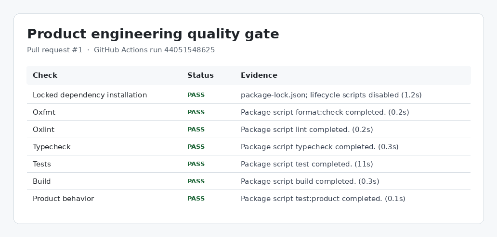

# Product engineering quality gate

A reusable GitHub Actions workflow for JS and TS repositories. It runs your own package scripts for
format, lint, typecheck, tests and build on every pull request, and fails the job if any of them
fail. Each run writes a PASS, FAIL or SKIPPED table to the job summary and uploads a JSON report.

You need Node 24 and one lockfile (npm, pnpm, Yarn or Bun) at the repository root.

[](https://github.com/DimitrisTheo-Dev/product-engineering-quality-gate/actions/runs/44051548625)

## Adopt it

```sh
git clone --branch v2.0.0 https://github.com/DimitrisTheo-Dev/product-engineering-quality-gate.git
cd product-engineering-quality-gate
node scripts/onboard.mjs --repo /path/to/your-repo          # dry run, writes nothing
node scripts/onboard.mjs --repo /path/to/your-repo --apply
```

`--apply` changes these files in your repository:

- `package.json` gets exact Oxfmt and Oxlint dev dependencies and two `quality:` scripts. Use
  `--preset biome` or `--preset existing` to keep your own tools.
- The lockfile is updated for those dependencies.
- `quality-gate.config.json` lists the checks and maps them to your `typecheck`, `test` and `build`
  scripts.
- `.github/workflows/product-quality.yml` calls this workflow pinned to the v2.0.0 commit.
- `.gitignore` gets `.quality-gate/`, where every run writes its report.

Run the same checks locally from your repository root, then open a pull request:

```sh
cd /path/to/your-repo
node /path/to/product-engineering-quality-gate/runtime/gate.mjs
```

The gate installs from your lockfile first, with lifecycle scripts disabled, as CI does. With the
Oxc preset, run `npx oxfmt` once after that install if the Oxfmt row fails on existing code, and
commit the result.

When `quality / Product engineering quality gate` passes, make it a required check.
[Local runs and onboarding options](docs/onboarding.md)

## What it reports

`quality-gate.config.json` describes the checks. A check is any package script, so a project can add
its own, such as a design linter:

```json
{
  "tools": ["typescript"],
  "checks": [
    { "name": "Typecheck", "kind": "typecheck", "script": "typecheck" },
    { "name": "Tests", "kind": "test", "script": "test:ci" },
    { "name": "Design rules", "kind": "design", "script": "design:check" },
    { "name": "Build", "kind": "build", "script": "build" },
    { "name": "Browser", "kind": "e2e", "script": "test:e2e", "tier": "deep" }
  ]
}
```

| Check                          | Status      | Evidence                                     |
| ------------------------------ | ----------- | -------------------------------------------- |
| Locked dependency installation | **PASS**    | `pnpm-lock.yaml; lifecycle scripts disabled` |
| Typecheck                      | **PASS**    | `Package script typecheck completed.`        |
| Tests                          | **FAIL**    | `Exit 1. Fix the diagnostics and rerun.`     |
| Design rules                   | **PASS**    | `Package script design:check completed.`     |
| Build                          | **PASS**    | `Package script build completed.`            |
| Browser                        | **SKIPPED** | `Enable deep to run this check.`             |

One failing check fails the job; the other checks still run and report. The JSON report also records
the script bodies, tool versions, skip reasons and timings. When a product omits typecheck, tests or
a build, an explicit waiver appears in the report.

## Three parts, one workflow

| Step            | Project                                                          | What it gives you                                                                                        |
| --------------- | ---------------------------------------------------------------- | -------------------------------------------------------------------------------------------------------- |
| Plan and design | [agent-skills](https://github.com/DimitrisTheo-Dev/agent-skills) | Skills that frame the work, set the design direction and review the rendered result                      |
| Build           | [dtheo/ui](https://github.com/DimitrisTheo-Dev/dtheo-ui)         | React components and engineering charts, an MCP server for agents, and `dtheo check` for design mistakes |
| Ship            | **product-engineering-quality-gate** (this repo)                 | A GitHub Actions gate that runs your checks, `dtheo check` included, and reports each one                |

Each part works alone.
[dtheo/ui](https://github.com/DimitrisTheo-Dev/dtheo-ui/actions/workflows/product-quality.yml) is
the reference adopter: its gate runs tokens, format, lint, typecheck, tests, `dtheo check`, the
build and an MCP trace check on every pull request.

[Configuration and schema](docs/configuration.md) · [Onboarding](docs/onboarding.md) ·
[v1 migration](MIGRATION.md) · [Benchmarks](docs/benchmarks.md) · [Releases](docs/releases.md) ·
[Architecture and cache trust](docs/architecture.md) · [Troubleshooting](docs/troubleshooting.md)
