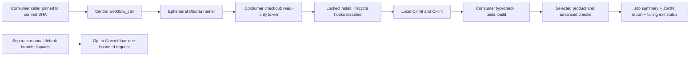

# Architecture and tradeoffs

The reusable workflow checks out the **caller** repository. It never expects a companion action or script to be present there. Its self-contained Node runner is generated from `runtime/gate.mjs`; generation checks and tests ensure the embedded code matches the locally exercised source. A release therefore carries its complete runtime without a second checkout or a moving helper reference.

The install root is the checkout root. `working-directory` selects the package whose scripts/configuration are used. npm, pnpm, and Yarn with `node_modules` are supported; there is one lockfile per invocation. Use root aggregate scripts or a small caller matrix for workspaces. Independent package lockfiles require separate invocations/repository layouts, not implicit discovery.

Checks run in one job and continue collecting evidence after individual failures. The runner records every verdict and exits nonzero if any executed check fails or required configuration is absent. It writes reports before returning. Upload and summary steps use explicit failure conditions; no step has `continue-on-error`. Setup failures produce an unavailable explanation and skipped checks.

One job avoids repeated installs and a large required-check matrix. Each command has a timeout and the job has a 30-minute ceiling. The caller owns concurrency so a reusable workflow cannot cancel its caller through a shared concurrency group. Expensive checks require explicit selection; Fallow/E2E/security also require `deep: true`. Do not use workflow path filters on a required gate unless another workflow guarantees its status.

## Security boundary

PR code is untrusted. It runs only on GitHub-hosted ephemeral Ubuntu runners with `contents: read`, no persisted checkout credentials, no provider secrets, no `secrets: inherit`, and no `pull_request_target`. The gate accepts script **names**, not arbitrary command strings inserted into shell YAML. It runs project-local exact-version Oxfmt/Oxlint rather than downloading fallback executables. Dependency hooks are disabled; necessary native/code-generation setup belongs in an explicitly reviewed `extra-script`.

There is no dependency cache in v1. A cold locked install is simpler to reason about and prevents untrusted PR jobs from writing a cache later consumed by a privileged job. If measured install times justify caching, add only package-download caching with lockfile/OS/runtime keys; do not share executable build caches across trust boundaries.

Code running in the PR job can falsify its own tests and logs. This is a quality gate, not a sandbox for adversarial maintainers or a cryptographic attestation. Protect workflow/config changes with review, restrict token permissions at the repository level, and avoid self-hosted runners for public contributions. Registry credentials/private dependencies need a separate reviewed design; v1 does not accept registry secrets for PR installs.

AI work uses a separate manual workflow, default-branch check, repository variable, confirmation, and an `ai-assist` environment. It installs/runs no consumer dependencies and does not execute model output. Provider keys exist only in that request step. Output is advisory; it cannot override deterministic failures.

## Deliberate limits

No package registry publication, central SaaS, automatic branch-policy edits, project-specific test framework, metric-driven refactoring, or universal agent instructions. Tool configuration and product assertions stay with the consumer. Native dependency setup is explicit. Standard Linux hosted runners, Node 24 LTS by default; Bun, Yarn PnP, independent nested install roots, GHES, and Windows are outside the verified v1 contract.
